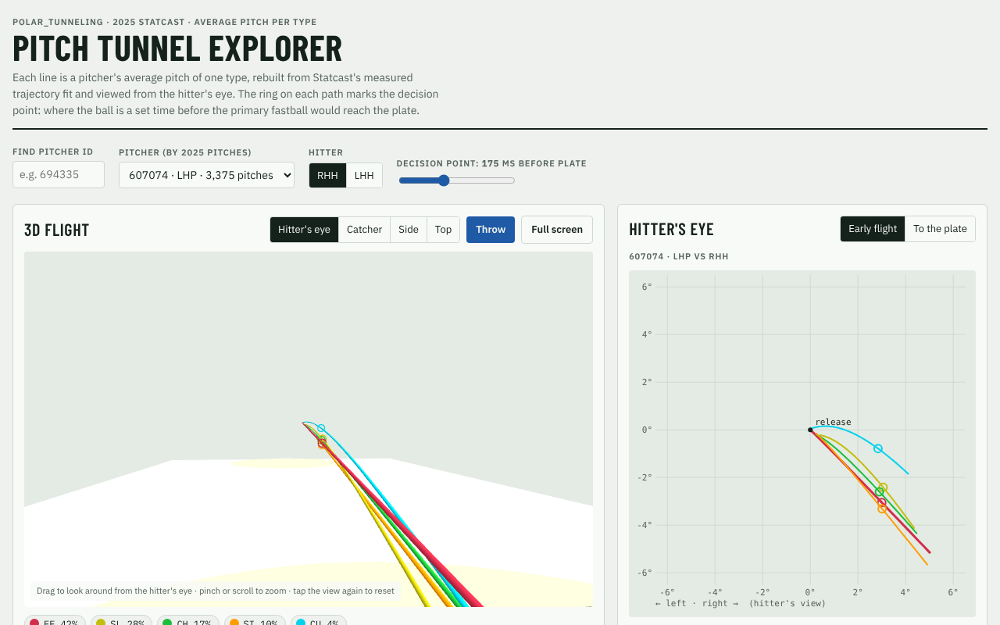
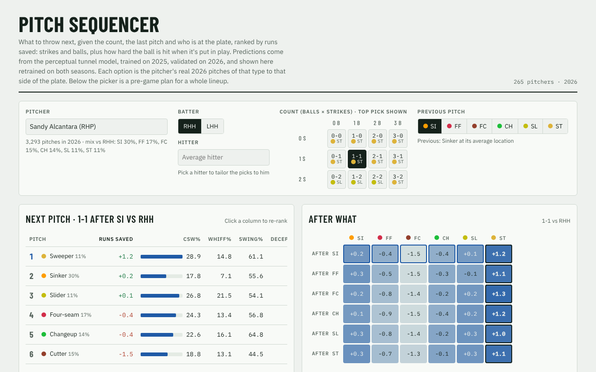
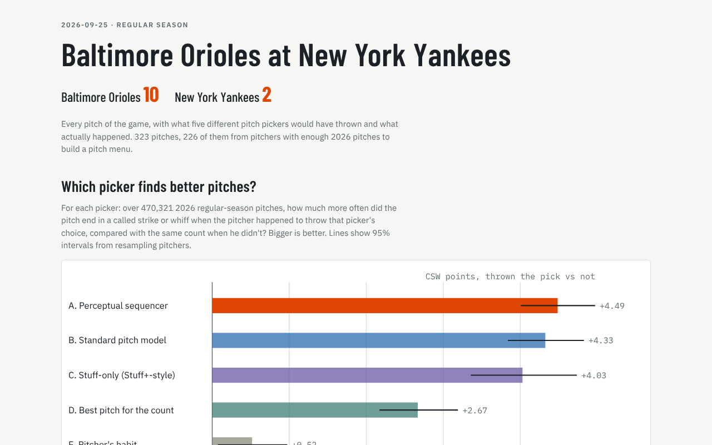
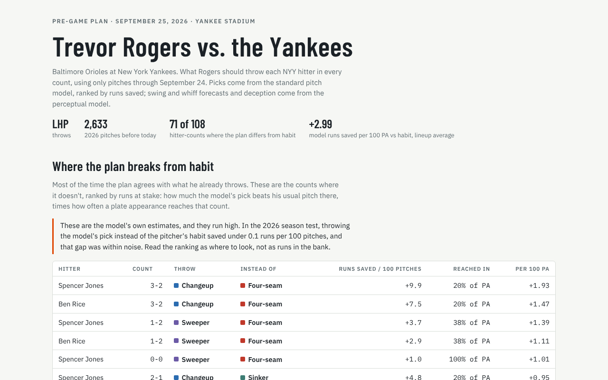

<div align="center">

# Polar Tunneling

Pitch tunneling measured from the hitter's eye: does a pitch that looks like another one early, then splits late, do better than its stuff and location say it should?

[](model/requirements.txt) [](https://baseballsavant.mlb.com/statcast_search) [](https://lightgbm.readthedocs.io) [](model/README.md) [](LICENSE)

</div>

Every pitch is rebuilt from Statcast's 9-parameter trajectory fit and turned into angles as seen from the
batter's eye, in real time rather than normalized flight time. The models train on 2025 and are tested once
on 2026, and every test is written down and committed before its outcome is computed, failures included.

> [!NOTE]
> **Credit.** The idea, the polar transformation and the first data pipeline are by
> [ginsy-codes](https://github.com/ginsy-codes), from
> [ginsy-codes/polar_tunneling](https://github.com/ginsy-codes/polar_tunneling). This repository carries
> that history and builds the models, tests and report pages on top of it. The original outline is in
> [docs/original_outline.md](docs/original_outline.md).

## Does polar tunneling work?

> [!IMPORTANT]
> **As a pitch-quality score, no. As a description of what the hitter sees, a little.** The original idea
> was that how closely a pitch's path matches the pitcher's fastball, seen from the batter's eye in
> polar coordinates, would predict results beyond what Stuff+ already captures, and could be scaled to a
> Tunnel+. After pre-registered tests trained on 2025 and checked once on 2026, that score doesn't hold
> up. What survived is smaller: the ball's position and motion at the moment the hitter decides adds a
> real but small amount to pitch-by-pitch forecasts.

| The original idea | Verdict | The evidence |
|---|---|---|
| Path similarity to the fastball predicts whiffs and strikes beyond stuff and location | **No** | Pitch types and locations already set 71% of early separation. Adding the tunnel features changed held-out log-loss by -0.6 to +0.5 per 1000, and raw whiff rates ran the wrong way (21% for the closest tenth of pitches, 28% for the farthest). The fastball version's weak 2025 signal didn't replicate in 2026 |
| A per-pitcher Tunnel+ (mean 100, SD 10) | **No** | Pitchers' tunnel values are very stable (split-half 0.93) because they reflect the arsenal, but they don't predict a pitcher's whiffs in other games (r = 0.02) |
| The hitter's view at the decision point carries information | **Yes, small** | Perceptual features improved 2026 forecasts (whiff per swing +1.8, swing +5.9 per 1000 log-loss), and the gain survived speed controls. Most of it is the ball's raw position and motion at the decision point. Expressing it as angles from the eye adds little on top |
| Each hitter has their own decision point | **No** | Fitted per-hitter timing made 2026 forecasts worse and didn't repeat between halves of 2025 (r = 0.04) |
| Tunneling should change which pitch to throw | **Rarely** | A sequencer with the perceptual features picks no better than the same model without them: +0.16 CSW pts (95% CI -0.06 to +0.38), and the same by runs |

The useful thing to come out of it is the [Pitch Sequencer](#try-it). It works because it models stuff,
location and count well, not because of tunneling. These tests cover the copy of the original repository
this one was made from. The original has since added path-integral correlations, which weren't tested here.

## Try it

<table>
<tr>
<td align="center" valign="top"><a href="https://jeffmhopkins.github.io/polar_tunneling/explorer/"></a><br><b><a href="https://jeffmhopkins.github.io/polar_tunneling/explorer/">Pitch Tunnel Explorer</a></b><br>Every 2025 arsenal in 3D, from the hitter's eye</td>
<td align="center" valign="top"><a href="https://jeffmhopkins.github.io/polar_tunneling/sequencer/"></a><br><b><a href="https://jeffmhopkins.github.io/polar_tunneling/sequencer/">Pitch Sequencer</a></b><br>Best next pitch by count, previous pitch and hitter</td>
</tr>
<tr>
<td align="center" valign="top"><a href="https://jeffmhopkins.github.io/polar_tunneling/game-report/"></a><br><b><a href="https://jeffmhopkins.github.io/polar_tunneling/game-report/">Game report</a></b><br>Orioles at Yankees, 2026-09-25, pitch by pitch against five pickers</td>
<td align="center" valign="top"><a href="https://jeffmhopkins.github.io/polar_tunneling/pregame/rogers.html"></a><br><b><a href="https://jeffmhopkins.github.io/polar_tunneling/pregame/rogers.html">Pre-game plan</a></b><br>Trevor Rogers vs the Yankees (also <a href="https://jeffmhopkins.github.io/polar_tunneling/pregame/young.html">Brandon Young</a>)</td>
</tr>
</table>

Every page runs in the browser with no server. [The index](https://jeffmhopkins.github.io/polar_tunneling/) lists them all, and
[Report pages](#report-pages) says how each one is built.

## For humans

> [!TIP]
> **Start with [Does polar tunneling work?](#does-polar-tunneling-work)**, then [What it found](#what-it-found),
> which covers every study and links to the report behind it. After that, [model/README.md](model/README.md)
> walks through each study in the order it was run.

- For the methods in one place (feature math, model settings, every test with its pass bar and CI, and
  the comparison with FanGraphs Stuff+, Pitching+ and PitchingBot), read the
  [methods and results review](https://jeffmhopkins.github.io/polar_tunneling/review/)
  (source: [docs/review/index.html](docs/review/index.html)).
- To see the results rather than read them, open the [pages above](#try-it): the Pitch Sequencer is the
  one to start with.
- To rerun a study, see [Running it](#running-it). The data is already in the repository.
- The project started from [the original outline](docs/original_outline.md), which is still the best
  explanation of why the hitter's-eye view matters.

## For agents

> [!IMPORTANT]
> **Read [CLAUDE.md](CLAUDE.md) first.** It is the jump start for a new session: what the project is,
> the layout, how to run the scripts and build the pages, and where the work was left.

The rules that matter most:

- Train on 2025 and test on 2026 **once**. A new variant gets a new test, never a rerun of an old one.
- Commit a `model/PREREG_<name>.md` before computing any outcome, and never edit it after the run.
- Report every result, failures included, in `model/<name>_report.md`, `model/README.md` and the table
  below.
- Run scripts from the repository root.

## What it found

| Question | Result | Write-up |
|---|---|---|
| Does a geometric tunnel score (pitch vs the previous pitch) add to stuff, location and count? | No. Pitch types and locations already pin down most of the separation | [feasibility](model/feasibility_report.md), [robustness](model/robustness_report.md) |
| Does an arsenal tunnel score (each pitch vs the fastball) predict whiffs? | Weak in 2025, did not replicate in 2026 | [2025](model/arsenal_report.md), [2026](model/arsenal_report_2026.md), [holdout](model/arsenal_holdout_report.md) |
| Do perceptual features (what the hitter sees and expects at the decision point) help? | **Yes**, pitch to pitch on 2026. No stable per-pitcher Tunnel+ | [perceptual](model/perceptual_report.md) |
| Is that just pitch speed? | No, the gain survives speed and flight-time controls | [speed check](model/speed_check_report.md) |
| Do the sequencer's top picks beat other pitches in real 2026 at-bats? | **Yes**, +4.5 CSW pts, about +3.6 after controlling for pitcher choice | [validation](model/validation_report.md), [choice](model/choice_report.md) |
| Does following it over a whole at-bat help? | **Yes**, through strikeouts (+1.2 K pts per +25 pts adherence), not weaker contact | [at-bat](model/atbat_report.md) |
| Does picking by runs instead of CSW help? | **Yes**, -0.27 runs per 100 pitches where the picks differ | [damage](model/damage_report.md) |
| Does a hitter-specific sequencer help? Does per-hitter timing? | Hitter-specific picks yes (+2.9 CSW pts where they differ). Fitted timing no | [hitter sequencer](model/hitter_sequencer_report.md), [hitter timing](model/hitter_timing_report.md) |
| Do the perceptual features change the *best* pitch, by CSW, runs or location? | No. They improve forecasts but rarely change the pick | [game](model/game_report.md), [runs](model/runs_report.md), [location](model/location_report.md) |
| After commit, is the pitcher's look-alike group a better reference than the fastball? | **Yes, small.** +0.52 per 1000 on whiff per swing over the full perceptual model, and 0.91 vs 0.36 head to head with the fastball read. Not tested on picks | [group read](model/group_report.md) |

[model/README.md](model/README.md) has every study in order, with its numbers and caveats. The [methods and results review](https://jeffmhopkins.github.io/polar_tunneling/review/) puts
the definitions, test design and picker comparison on one page.

## Terms

The terms used above. [model/README.md](model/README.md#variables) defines every model variable, and each
report walks through its own math under **How the model works**.

| Variable | Meaning | Units | Source |
|---|---|---|---|
| `CSW` | Share of pitches that are a called strike or whiff (`csw` averaged) | % or pts | `csw` |
| `pts` | Percentage points (a rate difference x100) | pts | - |
| `log-loss` | $`-\frac1n\sum_i [y_i\log\hat p_i + (1-y_i)\log(1-\hat p_i)]`$ on held-out pitches; lower is better | nats per pitch | `sklearn.metrics.log_loss` |
| `gain x1000` | $`1000\,(L_{\text{without}} - L_{\text{with}})`$: how much adding the features lowers held-out log-loss. + helps | nats per 1000 pitches | computed in each script |
| `r` | Pearson correlation | -1 to 1 | computed in each script |
| `split-half r` | Pearson correlation of a group's value in odd-`game_pk` games with its value in even-`game_pk` games | r | computed in each script |
| `95% CI` | 2.5th to 97.5th percentile of the statistic over a pitcher bootstrap: pitchers drawn with replacement, each pitcher's pitches weighted by how often he was drawn | - | `validate_sequencer.boot` |
| `Tunnel+` | A per-pitcher tunnel score scaled to mean 100, SD 10, as proposed in the original outline. Not built, because the pitcher-level tests failed | index | `docs/original_outline.md` |
| `Stuff+` | FanGraphs' pitch-quality grade (100 = average) from velocity, movement, spin and release; Pitching+ also grades location, and PitchingBot is a separate pitch model. Used here as public comparison pickers | index | `datamining/outputs/fangraphs_grades_2025.csv` |
| `P1-P6` | The six perceptual feature blocks: timing, fastball-prior miss, optical motion, ambiguity, expectation, at-bat build-up | - | `perceptual.P` |
| `top pick` | The candidate type with the highest predicted CSW in the cell | - | `validate_sequencer.test_pitches` |
| `K pts` | Strikeout rate difference in percentage points | pts | `validate_atbat.py` |
| `adherence` | Mean over a PA's scored pitches of (matched minus the pitcher x side x count 2026 match rate) | share | `validate_atbat.scored_pitches`, `pa_table` |
| `xwoba` | Expected wOBA of the plate appearance, on its last pitch: from exit speed and launch angle for a ball in play, the wOBA weight for a walk or HBP, 0 for a strikeout | wOBA scale | Statcast column `estimated_woba_using_speedangle` (`datamining/outputs`) |
| `runs per 100 pitches` | Run value per 100 pitches; negative means fewer runs allowed | runs | `damage_sequencer.py`, `runs_compare.py` |
| `TAU` | Commit point: how long before the ball reaches the front of the plate the hitter must decide. Fixed at 0.175 s unless stated | s | `features.TAU` |

## Layout

| Folder | What's in it |
|---|---|
| [datamining](datamining) | Statcast pulls (pybaseball and Baseball Savant), the columns added to them later, FanGraphs grades, and the monthly pitch CSVs in `outputs/` |
| [polar_transformations](polar_transformations) | Trajectory rebuild from the 9-parameter fit, and the batter's-eye polar transform |
| [model](model) | Features, models, pre-registrations (`PREREG_*.md`), the scripts that run them and the reports they write |
| [report_generation](report_generation) | HTML templates and builders for the Pitch Sequencer, game report and pre-game plan, plus the [Pitch Tunnel Explorer](report_generation/explorer) |

## Running it

```sh
pip install -r datamining/requirements.txt -r model/requirements.txt -r report_generation/requirements.txt
```

> [!NOTE]
> The pitch data for both seasons is already in `datamining/outputs/` (about 470 MB), so the models run
> without pulling anything. Run scripts from the repository root: paths are relative to it.

Each model script writes its report next to it, for example:

```sh
python model/perceptual.py                 # writes model/perceptual_report.md
python model/damage_sequencer.py --production
python report_generation/build_sequencer.py sequencer.html
```

To pull the data again, run `pull_2025_chunked.py` and `pull_2026_pitches.py`, then `add_velocities.py`,
`add_context.py` and `add_bat_tracking.py` with `--year 2025` and `--year 2026`. Each script's docstring
says what it adds.

## Report pages

| Page | Built by | Data from |
|---|---|---|
| [Pitch Sequencer](https://jeffmhopkins.github.io/polar_tunneling/sequencer/) | `report_generation/build_sequencer.py OUT.html` | `model/sequencing.json`, `model/batter_adj/` |
| [Game report](https://jeffmhopkins.github.io/polar_tunneling/game-report/) | `report_generation/build_game_report.py 823491 OUT.html` | `model/game_report.py`, `runs_compare.py`, `location_compare.py` |
| [Pre-game plan](https://jeffmhopkins.github.io/polar_tunneling/pregame/rogers.html) | `report_generation/build_pregame.py 823491 669432 OUT.html` | `model/pregame_report.py` |
| [Methods and results review](https://jeffmhopkins.github.io/polar_tunneling/review/) | Written by hand: [docs/review/index.html](docs/review/index.html) | `model/*_report.md` |
| [Pitch Tunnel Explorer](https://jeffmhopkins.github.io/polar_tunneling/explorer/) | [report_generation/explorer](report_generation/explorer) | 2025 Statcast trajectory fits |

Each page is one self-contained HTML file, except the sequencer, which loads hitter data from an `adj/`
folder copied next to it. The published copies live on the `gh-pages` branch.

## Data

Pitch data is from [Baseball Savant](https://baseballsavant.mlb.com) (MLB Advanced Media), pulled with
[pybaseball](https://github.com/jldbc/pybaseball). Stuff+, Pitching+ and PitchingBot grades are from
[FanGraphs](https://www.fangraphs.com). Both are subject to their owners' terms.

## License

[MIT](LICENSE). The pitch data in `datamining/outputs/` is not covered by it: it stays under Baseball
Savant's and FanGraphs' terms.
